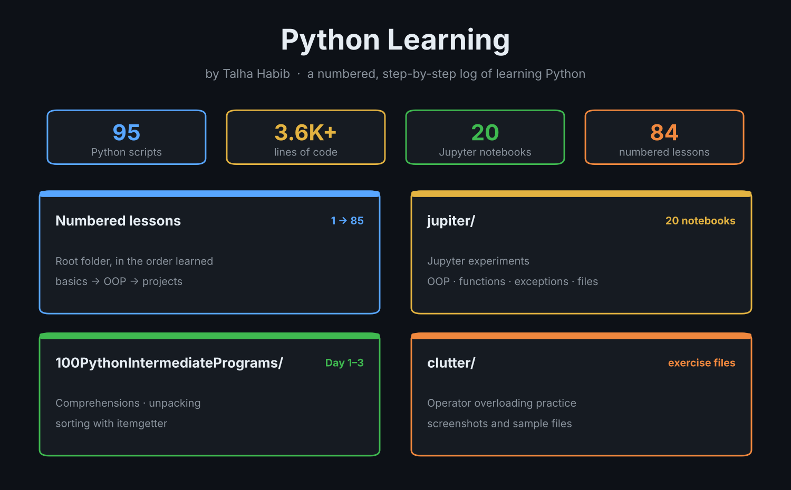
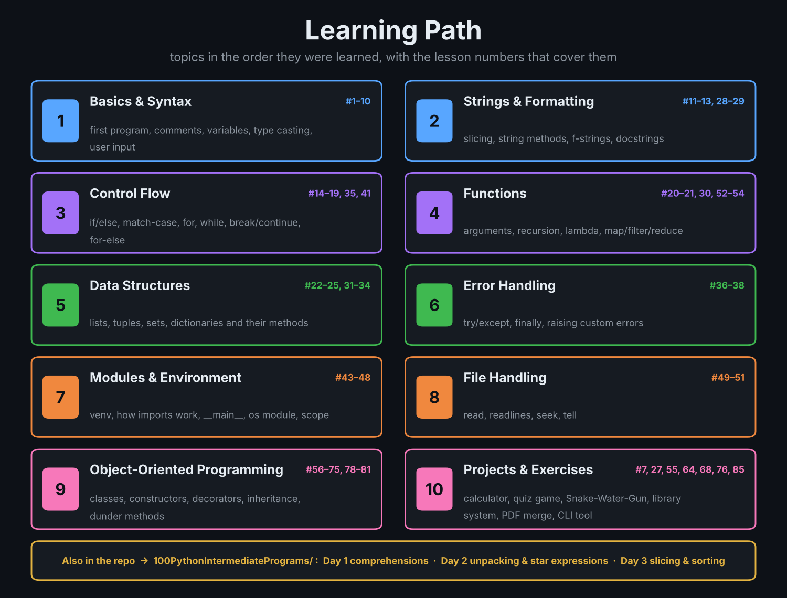
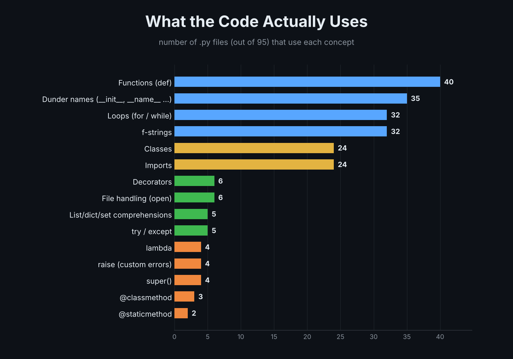

# Python Learning



A personal, step-by-step log of learning Python from the ground up: **95 Python scripts, 20 Jupyter notebooks and 3,600+ lines of code**, covering syntax, control flow, functions, data structures, error handling, file handling, and object-oriented programming, plus small projects.

**Author:** Talha Habib

> Lessons in the root folder are numbered in the order the topics were learned, so the repo doubles as a course log. Read them in numeric order (`1…py` → `85…py`) for a beginner-to-intermediate path.

---

## What's inside

| Location | What it contains |
|---|---|
| Root folder (`1…py` – `85…py`) | 84 numbered lessons and exercises, in the order learned |
| [`jupiter/`](jupiter) | 20 Jupyter notebooks: OOP, functions, exceptions, file handling, modules, loops, and more |
| [`100PythonIntermediatePrograms/`](100PythonIntermediatePrograms) | Intermediate practice (Day 1–3): comprehensions, unpacking & star expressions, slicing and sorting |
| [`clutter/`](clutter) | Extra exercise files (e.g. operator overloading, lesson 77), screenshots and sample files |

---

## Learning path



---

## Topics covered

The chart shows how many of the 95 `.py` files use each concept.



### Basics & Syntax
- Intro to programming and Python, first program, comments and escape sequences
- Variables, data types, type casting
- User input, strings, slicing, string methods, f-strings, docstrings

### Control Flow
- `if` / `else`, short-hand if-else, `match`-`case`
- `for` and `while` loops, `break` / `continue`, `for` loop with `else`, `enumerate`

### Functions
- Functions and function arguments, recursion
- `lambda`, `map`, `filter`, `reduce`
- `is` vs `==`

### Data Structures
- Lists, tuples, sets, dictionaries, and their methods
- List / dict / set comprehensions, unpacking and star expressions, sorting with `itemgetter`

### Error Handling
- `try` / `except`, `finally`, raising custom errors

### Modules & Environment
- Modules and `pip`, how imports work, virtual environments
- `os` module, `time` module, `if __name__ == "__main__"`, local vs global variables

### File Handling
- File I/O basics, `read()`, `readlines()`, `seek()`, `tell()`

### Object-Oriented Programming
- Classes and objects, constructors, getters and setters, access modifiers
- Decorators, static methods, class methods, instance vs class variables
- Inheritance: single, multiple, multilevel, hierarchical and hybrid
- `super()`, method overriding, magic / dunder methods, operator overloading
- `dir()`, `__dict__`, `help()`

### Projects & Exercises
- Calculator
- "Kaun Banega Crorepati" quiz game
- Snake, Water, Gun game
- Library management system
- "Clear the clutter" exercise
- PDF merging
- Command-line utility
- Pronouncing a list of names with the Windows speech API

---

## Getting started

```bash
# clone
git clone https://github.com/TalhaHabib-hub/Python-Learning.git
cd Python-Learning

# run any lesson
python 20FunctionsInPython.py
```

A few scripts need extra packages:

| Script | Needs |
|---|---|
| PDF merging (lessons 76 and 82) | `pip install PyPDF2` |
| Command-line utility (lesson 85) | `pip install requests` |
| Names pronouncer (lesson 83) | `pip install pywin32` (Windows only) |

---

## Purpose

- A **learning log** tracking progress through core Python concepts
- A **quick reference** for revisiting topics (loops, OOP, file handling, …)
- A **practice ground** for small exercises and mini projects

## Contributing

This is a personal learning repository and isn't actively seeking contributions, but feel free to explore, fork, or open an issue if you spot something worth discussing.

## Author

**Talha Habib**: [@TalhaHabib-hub](https://github.com/TalhaHabib-hub)
